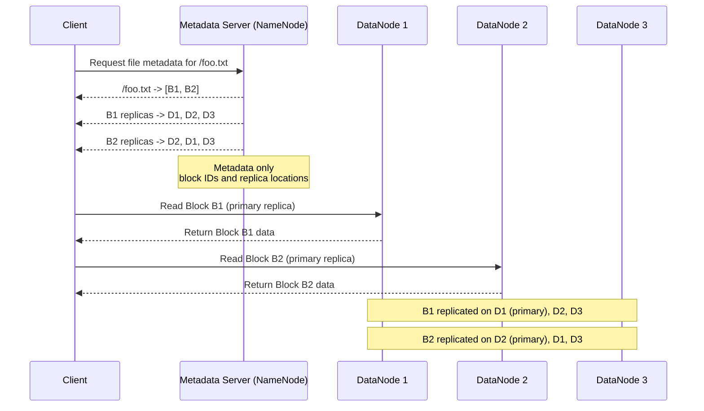

# Distributed File Systems

A distributed file system (DFS) presents a shared file namespace across many machines while storing data in chunks on a cluster of commodity servers.

It is designed for large files, high throughput, and fault tolerance — not low-latency random small writes on a single machine.

Common use cases:

- Big data storage for batch analytics (HDFS + MapReduce/Spark)
- Shared storage for compute clusters
- Large log/media/archive datasets
- On-prem or cloud data lake foundations

## Why Not a Single Server or NAS?

Traditional NFS/SAN approaches hit limits:

- Single-server capacity and throughput ceiling
- Harder to scale storage and bandwidth independently
- Weaker fault tolerance for very large datasets

DFS spreads **metadata routing**, **data blocks**, and **replication** across many nodes.

## GFS/HDFS-Style Architecture

The classic model (Google File System, Hadoop HDFS):

Control plane (metadata server):

- File namespace (paths, directories)
- Mapping: file -> list of chunk/block IDs
- Block location (which data nodes hold replicas)
- Lease/lock coordination for writes (in some designs)

Data plane (storage nodes):

- Store fixed-size chunks/blocks (for example, 64 MB or 128 MB)
- Serve read/write IO directly to clients
- Report heartbeats and disk health to master

Clients often read/write data **directly from data nodes** after metadata lookup and re-assemble the file from the chunks.

## Fixed-Size Chunks

DFS optimizes for sequential reads/writes on big files.

Typical pattern:

- Split file into chunks (64 MB common in GFS/HDFS)
- Replicate each chunk (replication factor 3 is common)
- Append-heavy workloads favored over random in-place edits

Benefits:

- ✅ Simplifies replication and recovery at chunk granularity
- ✅ Enables locality-aware compute (process data near storage)
- ❌ Poor fit for many small random updates

See [MapReduce](./03-mapreduce.md) for why chunk locality matters.

## Read and Write Flow

### Read

1. Client asks metadata server for file -> chunk mapping
2. Metadata server returns chunk IDs + replica locations
3. Client reads from nearest/fastest replica data node and re-assembles the file from the chunks.

### Write / Append

1. Client requests lease (lock) on chunk from metadata server
2. Primary replica coordinates chunk write order
3. Data pushed to replica pipeline and acknowledged by the primary replica
4. Acknowledgments propagate back; metadata updated

Many DFS designs favor **append-only** writes to keep consistency manageable.

## Replication and Fault Tolerance

Each chunk is stored on multiple data nodes (often across racks).

On node failure:

- Heartbeat timeout detects dead data node
- Metadata server marks affected replicas unavailable
- System re-replicates under-replicated chunks to restore target replication factor

This is data redundancy via replication. See [Redundancy vs Replication](../fundamentals/32-redundancy-vs-replication.md).

Rack-awareness:

- Place replicas in different racks to survive top-of-rack switch failure
- Trade-off: cross-rack replication adds network cost

## Consistency Model

GFS/HDFS-style systems usually provide:

- **Strong metadata consistency** (single metadata master or HA pair)
- **Relaxed file data consistency** for concurrent writers

Practical implications:

- Single writer append can be well supported
- Concurrent writers to same file region may need app-level coordination
- Readers may briefly see incomplete writes until close/commit semantics

Not a substitute for POSIX guarantees on every operation.

## Metadata Server Availability

The metadata layer is a critical control point.

Patterns:

- Single master + standby (classic HDFS NameNode HA with journal nodes)
- Checkpointing / fsimage + edit logs for metadata recovery
- Federation (multiple metadata namespaces) for scale-out metadata

Metadata scaling is often harder than data scaling.

## Design Trade-offs

Benefits:

- ✅ Horizontal storage and throughput scale
- ✅ Fault tolerance through chunk replication
- ✅ Data locality for batch compute jobs

Costs:

- ❌ Metadata server complexity and HA burden
- ❌ Not ideal for low-latency OLTP or many small files
- ❌ Operational overhead (rebalancing, under-replication, rack awareness)

## Design Guidelines

- Optimize for large sequential reads/writes unless requirements say otherwise
- Pick chunk size based on workload (too small -> metadata bloat; too large -> imbalance)
- Use replication + rack awareness for failure domains
- Monitor under-replicated blocks, data node health, and metadata HA failover
- Separate hot metadata paths from bulk data paths in architecture discussions

## Interview Talking Points

- Draw control plane (metadata) vs data plane (chunk servers) explicitly.
- Explain chunking + replication factor + re-replication after node loss.
- Clarify why append/large-file workloads fit better than random small writes.
- Compare DFS with object storage when interviewer asks "why not S3?"
- Mention metadata HA as a common bottleneck/SPOF concern.

## Reference Materials

- [The Google File System (GFS Paper, 2003)](https://static.googleusercontent.com/media/research.google.com/en//archive/gfs-sosp2003.pdf)
- [Apache Hadoop HDFS Architecture Guide](https://hadoop.apache.org/docs/stable/hadoop-project-dist/hadoop-hdfs/HdfsDesign.html)
- [MapReduce Paper (data locality context)](https://static.googleusercontent.com/media/research.google.com/en//archive/mapreduce-osdi04.pdf)
